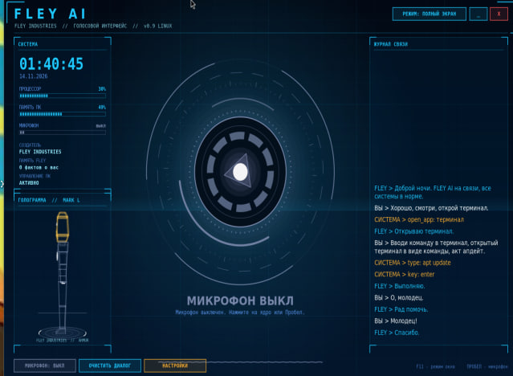
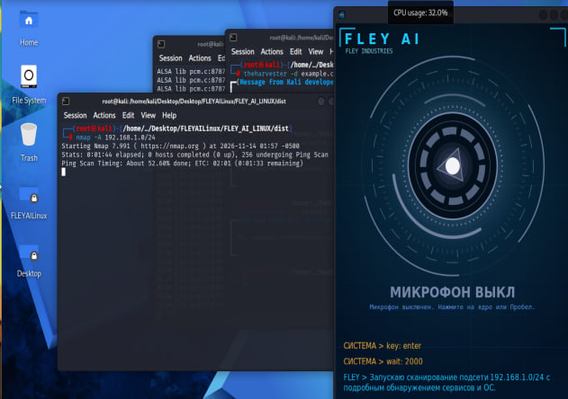
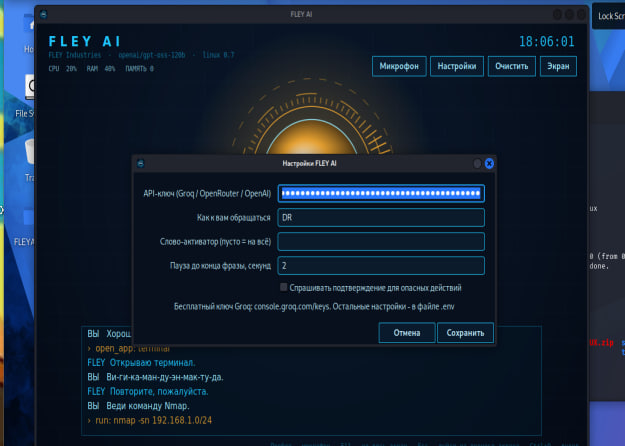

# FLEY AI для Linux

FLEY AI-Voce is a voice-activated AI assistant that not only talks to you but can also control your PC: open links, websites, and programs, create files and presentations, write code, and even turn your PC on and off, operate your printer, and do virtually anything else.

FLEY AI-Voce — голосовой AI-ассистент, который не только будет с вами разговаривать, но и сможет управлять вашим ПК: открывать ссылки, сайты и программы, создавать файлы, презентации, писать код и даже выключать и включать ПК, работать с принтером и делать практически что угодно.

https://fleyaidownload.netlify.app/







Настойки нужно так

Я не могу дать свой API, потому что сервис меня заблокирует за превышение лимитов. Но ты можешь прямо сейчас за 1 минуту получить свой собственный бесплатный ключ вот здесь: https://console.groq.com/keys и вставить в .env GROQ_API_KEY=<Таое API>


### Быстрая установка (.deb)
1. [Скачать fley-ai_0.9.0_amd64.deb](https://github.com)
2. Установить через терминал:
   ```bash
   sudo apt install ./fley-ai_0.9.0_amd64.deb


```bash
tar -xzvf FAILinux.tar.gz

./fley-ai

```


```bash
unzip FLEY_AI_LINUXgg1v.zip && cd FLEY_AI_LINUX

./build.sh --install-deps

cd dist

./flеy-ai
```


## Запуск (один скрипт)
```bash
bash bulid.sh

cd build

./flеy-ai
```

```bash
unzip FLEY_AI_LINUX.zip && cd FLEY_AI_LINUX
bash build.sh
```

# Без root:

```bash
cd FLEYAILinux/build

./fley-ai
```
# для gg2v

```bash
unzip FLEY_AI_LINUXgg2v.zip && cd FLEY_AI_LINUX
./install_voice.sh      # живой голос
./build.sh --run
```

# для gg3v
```bash
unzip -o FLEY_AI_LINUXgg3v.zip && cd FLEY_AI_LINUX
./install_voice.sh     # поставит edge-tts + ffmpeg и проверит голос
./build.sh --run
```

Скрипт сам: поставит пакеты (apt / dnf / pacman / zypper), соберёт программу, создаст ярлык «FLEY AI» и запустит окно.
Если ключа ещё нет, окно настроек откроется само: вставьте ключ Groq (бесплатно: console.groq.com/keys).

Дальше запускайте ярлыком «FLEY AI» из меню приложений или командой `fley-ai`.
Флаги: `--no-deps` (не ставить пакеты), `--no-run` (не запускать), `--uninstall` (удалить).

## Управление
Пробел или клик по ядру: микрофон вкл/выкл (во время речи FLEY - прервать). F11: полный экран. Ctrl+Q: выход.

## Где что лежит
- Настройки и ключ: `~/.config/fley-ai/.env`
- Память, история, лог: `~/.local/share/fley-ai/`

## Что используется
curl (запросы), arecord (микрофон), espeak-ng (локальный голос), paplay/aplay (звук), xdotool (клавиши и ввод),
pactl (громкость), playerctl (медиа), xdg-open (ссылки и папки), gio trash (корзина).

## Wayland
Нажатие клавиш и набор текста (`xdotool`) на Wayland работают только в части приложений.
Для полной работы выберите сеанс «Xorg» на экране входа. Остальное (голос, ИИ, программы, YouTube, файлы) работает везде.

## Если что-то не работает
- Нет голоса: `sudo apt install espeak-ng pulseaudio-utils`
- Не слышит микрофон: `arecord -l`, затем укажите устройство в `FLEY_MIC_DEVICE`
- Лог ошибок: `~/.local/share/fley-ai/fley.log`

# FLEY AI для Linux

Голосовой ИИ-помощник для компьютера: слушает постоянно, отвечает голосом, открывает программы, ищет в интернете, включает музыку, управляет громкостью и многое другое. Говорите как с человеком, кнопок нажимать не нужно.

## 1. Установка и запуск

```bash
unzip FLEY_AI_LINUX.zip
cd FLEY_AI_LINUX
bash build.sh
```

Скрипт сам ставит нужные пакеты (спросит пароль sudo), собирает программу, создаёт ярлык «FLEY AI» в меню приложений и запускает окно. Нужен интернет.

Потом запускайте ярлыком «FLEY AI» или командой `fley-ai`.

Рекомендуем запускать от обычного пользователя, не от root: звук и микрофон под root часто не работают.

### Первый запуск: ключ
1. Получите бесплатный ключ на https://console.groq.com/keys (начинается с `gsk_`).
2. В окне нажмите «Настройки», вставьте ключ, оставьте «Слово-активатор» **пустым**, нажмите «Сохранить».
3. Скажите «привет».

## 2. Как понять, что работает: журнал в окне

При запуске в журнале (нижняя панель) появляются проверки:

| Строка | Значение |
|---|---|
| `✓ curl` | всё хорошо |
| `✗ микрофон (arecord) - sudo apt install alsa-utils` | не хватает программы, выполните команду из строки |
| `✗ связь с api.groq.com` | нет интернета или VPN |
| `! Голос-робот espeak-ng` | не установился нейро-голос, запустите `bash build.sh` ещё раз |

Что вы сказали, видно строкой `ВЫ ...`. Ответ ассистента: `FLEY ...`. Выполненные действия: `› open_app: ...`.
Версия программы написана вверху окна (например `linux 0.7`).

## 3. Микрофон: как проверить и включить

### Шаг 1. Видит ли система микрофон
```bash
arecord -l
```
Если в ответе есть строка `card 0: ...`, микрофон найден. Если написано `no soundcards found`, системе микрофон не виден (см. раздел про виртуальные машины ниже).

### Шаг 2. Записывается ли звук
```bash
arecord -d 5 -f cd /tmp/test.wav && aplay /tmp/test.wav
```
Скажите что-нибудь в течение 5 секунд. Если слышите свой голос в записи, микрофон работает. Если тишина, переходите к шагу 3.

### Шаг 3. Микрофон выключен или тихий
```bash
pactl set-source-mute @DEFAULT_SOURCE@ 0
pactl set-source-volume @DEFAULT_SOURCE@ 100%
```
Или графически: `alsamixer` -> клавиша F4 (запись) -> выберите Capture/Mic -> пробел включает, стрелки меняют громкость. Либо откройте «Параметры звука» -> «Ввод» и выберите нужный микрофон.

Список источников записи: `pactl list short sources`.

### Шаг 4. Несколько микрофонов (выбрать нужный)
Найдите имя устройства (`arecord -L`) и впишите его в `~/.config/fley-ai/.env`:
```
FLEY_MIC_DEVICE=plughw:1,0
```
Подойдёт и значение `pulse` (системный микрофон по умолчанию).

### Слишком тихо или программа плохо распознаёт
```
FLEY_MIC_GAIN=3
FLEY_STT_MODEL=whisper-large-v3
```
Говорите ближе к микрофону, чётко, без спешки.

## 4. Виртуальная машина (VirtualBox, VMware, GNOME Boxes)

Из виртуалки микрофон по умолчанию **не виден**, его надо пробросить.

**VirtualBox**
1. Выключите виртуалку.
2. Настройки -> Звук (Audio) -> поставьте галочки **«Включить звуковой вывод»** и **«Включить звуковой ввод»** (Enable Audio Input).
3. Звуковой контроллер: Intel HD Audio (или ICH AC97).
4. В Windows: Параметры -> Конфиденциальность -> Микрофон -> разрешите доступ классическим приложениям (VirtualBox).
5. Запустите виртуалку и снова выполните `arecord -l`.

**VMware Workstation / Player**
1. Выключите виртуалку.
2. Settings -> Add -> **Sound Card** (Connection: Use default host sound card).
3. Микрофон берётся из устройства записи по умолчанию на основном компьютере. Проверьте его в настройках звука хоста.
4. Если микрофон на хосте — Bluetooth-гарнитура, используйте обычный (проводной или встроенный).

**GNOME Boxes / virt-manager (QEMU)**
Добавьте звуковое устройство (модель `ich9` или `hda`), для записи нужен проброс микрофона хоста.

Проверка после включения: снова шаги 1 и 2 из раздела про микрофон.

## 5. Частые проблемы

| Проблема | Что делать |
|---|---|
| Окно открылось, но на слова не отвечает | Откройте «Настройки», слово-активатор должно быть пустым. Смотрите журнал: строка `ВЫ ...` значит, что вас услышали. |
| Слышит, но пишет «речь не распознана» | Микрофон тихий: `FLEY_MIC_GAIN=3`, говорите ближе. |
| Статус не меняется, нет звука | Проверьте микрофон (раздел 3) и воспроизведение: `aplay /usr/share/sounds/alsa/Front_Center.wav`. |
| Голос-робот | Запустите `bash build.sh` ещё раз (поставится нейро-голос). Проверка: `~/.local/share/fley-ai/venv/bin/edge-tts --voice ru-RU-DmitryNeural --text "Привет" --write-media /tmp/t.mp3 && mpg123 /tmp/t.mp3` |
| Голос прерывистый или хрипит | `sudo apt install ffmpeg`, затем в `.env`: `FLEY_PLAYER=ffplay` |
| `✗ связь с api.groq.com` | Нет интернета или VPN. Проверьте: `curl -I https://api.groq.com` |
| Ошибка про ключ (401) | Ключ неверный. Создайте новый на console.groq.com/keys и вставьте в «Настройки». |
| Ошибка про лимит | Бесплатный лимит Groq. Подождите минуту или поменяйте модель в `.env`. |
| Не работает набор текста и нажатие клавиш | На Wayland `xdotool` работает не везде. При входе выберите сеанс «Xorg». |
| Окно не собирается | Пришлите последние строки вывода `bash build.sh`. |

## 6. Что умеет (примеры)

- «Открой браузер», «открой терминал», «открой Telegram»
- «Включи музыку на ютубе», «включи Imagine Dragons»
- «Сделай погромче», «выключи звук», «следующий трек»
- «Какая нагрузка на компьютере?», «найди файл отчёт»
- «Какая сегодня погода?», «курс доллара» (поиск в интернете)
- «Заблокируй компьютер», «поставь таймер на пять минут»
- «Запомни, что меня зовут ...»

Управление в окне: **Пробел** или клик по ядру — микрофон вкл/выкл (во время речи прерывает ответ), **F11** — полный экран, **Ctrl+Q** — выход.

## 7. Где что лежит

- Настройки и ключ: `~/.config/fley-ai/.env`
- Память, история, лог ошибок: `~/.local/share/fley-ai/` (лог: `fley.log`)
- Программа: `~/.local/share/fley-ai/fley-ai`

Не отправляйте файл `.env` другим людям: в нём ваш ключ.

## 8. Обновление и удаление

Обновить: распакуйте новую версию и снова выполните `bash build.sh`.
Удалить: `bash build.sh --uninstall` (настройки и память останутся).

Флаги: `--no-deps` (не ставить пакеты), `--no-run` (не запускать после сборки).

