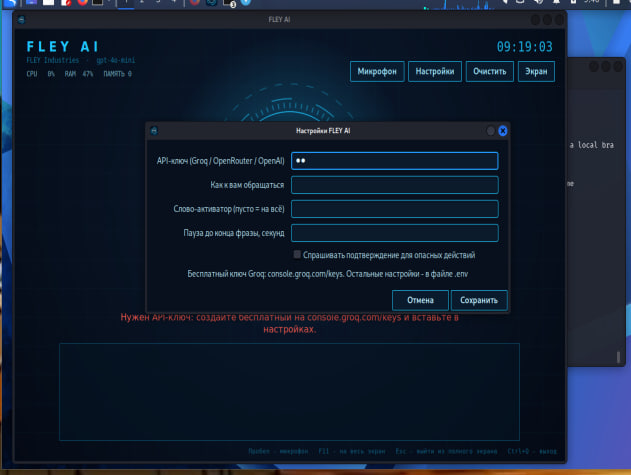
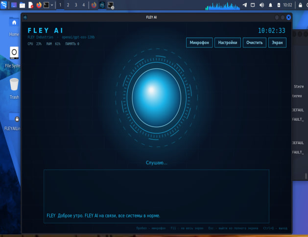

# FLEY AI для Linux

Тот же FLEY AI, что и на Windows (HUD-окно, постоянное прослушивание, управление ПК голосом, память), но под Linux.
Логика (`src/core.hpp`) общая с Windows-версией, окно переписано на GTK3.






Настойки нужно так

## Запуск (один скрипт)
```bash
bash bulid.sh

cd build

./flеy-ai
```

```bash
unzip FLEY_AI_LINUX.zip && cd FLEY_AI_LINUX
bash build.sh
```

# Без root:

```bash
cd FLEYAILinux/build

./fley-ai
```


Скрипт сам: поставит пакеты (apt / dnf / pacman / zypper), соберёт программу, создаст ярлык «FLEY AI» и запустит окно.
Если ключа ещё нет, окно настроек откроется само: вставьте ключ Groq (бесплатно: console.groq.com/keys).

Дальше запускайте ярлыком «FLEY AI» из меню приложений или командой `fley-ai`.
Флаги: `--no-deps` (не ставить пакеты), `--no-run` (не запускать), `--uninstall` (удалить).

## Управление
Пробел или клик по ядру: микрофон вкл/выкл (во время речи FLEY - прервать). F11: полный экран. Ctrl+Q: выход.

## Где что лежит
- Настройки и ключ: `~/.config/fley-ai/.env`
- Память, история, лог: `~/.local/share/fley-ai/`

## Что используется
curl (запросы), arecord (микрофон), espeak-ng (локальный голос), paplay/aplay (звук), xdotool (клавиши и ввод),
pactl (громкость), playerctl (медиа), xdg-open (ссылки и папки), gio trash (корзина).

## Wayland
Нажатие клавиш и набор текста (`xdotool`) на Wayland работают только в части приложений.
Для полной работы выберите сеанс «Xorg» на экране входа. Остальное (голос, ИИ, программы, YouTube, файлы) работает везде.

## Если что-то не работает
- Нет голоса: `sudo apt install espeak-ng pulseaudio-utils`
- Не слышит микрофон: `arecord -l`, затем укажите устройство в `FLEY_MIC_DEVICE`
- Лог ошибок: `~/.local/share/fley-ai/fley.log`
